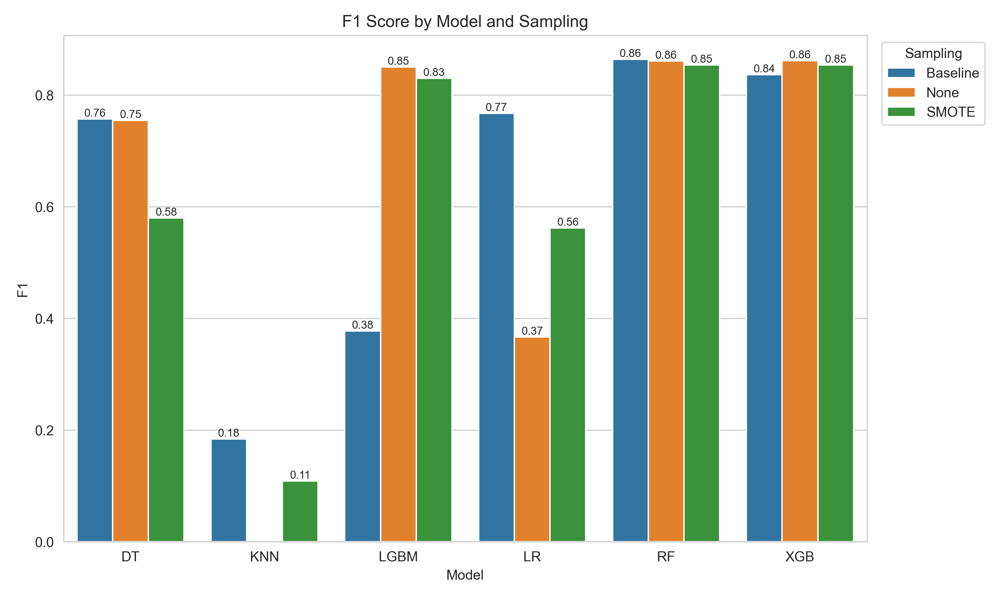
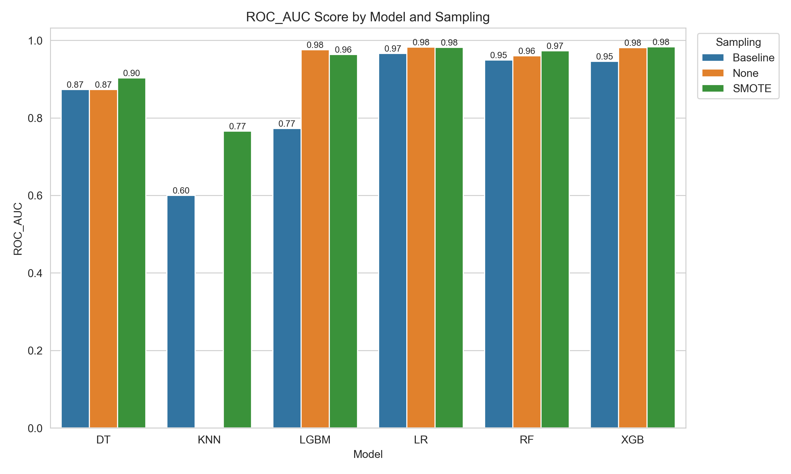

# Credit Card Fraud Detection

How well do standard classifiers catch fraud when only 0.17% of transactions are fraudulent? This project compares six models, each with three ways of handling the imbalance, on the well-known European credit card dataset from the ULB Machine Learning Group.

Group project for COMP 4170 (Data Mining) at the University of Manitoba, Fall 2025.

## Results

Scores are averaged over 2 runs. The table shows each model's best variant by F1.

| Model | Best variant | Precision | Recall | F1 | ROC-AUC |
| --- | --- | --- | --- | --- | --- |
| Random Forest | Baseline | 0.935 | 0.804 | 0.864 | 0.949 |
| XGBoost | Class weights | 0.920 | 0.811 | 0.862 | 0.981 |
| LightGBM | Class weights | 0.889 | 0.814 | 0.850 | 0.976 |
| Logistic Regression | Baseline | 0.807 | 0.733 | 0.767 | 0.966 |
| Decision Tree | Baseline | 0.768 | 0.747 | 0.757 | 0.873 |
| KNN | Baseline | 0.761 | 0.105 | 0.184 | 0.600 |

- **Tree ensembles lead.** Random Forest, XGBoost and LightGBM reach an F1 of about 0.85 to 0.86 at their best. XGBoost with SMOTE has the highest ROC-AUC (0.983).
- **Imbalance handling helps some models and hurts others.** LightGBM's F1 jumps from 0.377 at baseline to 0.850 with class weights and 0.830 with SMOTE. For the Decision Tree and Logistic Regression, SMOTE lowers F1 (0.757 to 0.580 and 0.767 to 0.562) because precision drops.
- **ROC-AUC alone can mislead.** Logistic Regression with class weights ranks second on ROC-AUC (0.983) but has an F1 of only 0.367, because its precision is 0.233.
- **KNN does worst.** At baseline it catches about 10% of fraud (recall 0.105).





In the charts, **Baseline** means no resampling or weighting, **SMOTE** means oversampling the training set, and **None** means no resampling but balanced class weights. KNN has no class-weight option.

Every run is in [`results/metrics.csv`](results/metrics.csv), and the averaged tables are in [`results/tables/`](results/tables/). There is also a heatmap per metric and a radar chart of the top three models in [`results/plots/`](results/plots/).

## How the experiments work

- **Data:** 284,807 transactions with 492 frauds (0.173%). The 30 features are `Time`, `Amount` and 28 anonymized PCA components (`V1` to `V28`). The dataset is not in this repository, see [`data/README.md`](data/README.md).
- **Split:** a stratified 70/30 train/test split, with a different random seed for each run.
- **Variants:** *Baseline*, *SMOTE* (applied to the training set only) and *class weights* (`class_weight="balanced"`, or `scale_pos_weight` for XGBoost).
- **Models:** Logistic Regression, Decision Tree, Random Forest (100 trees), KNN, XGBoost and LightGBM.
- **Metrics:** precision, recall, F1 and ROC-AUC on the test set. Precision, recall and F1 use the decision threshold between 0.10 and 0.90 that gives the best F1.

## Limitations

- **The threshold is tuned on the test set.** The same split is used to pick the threshold and to report scores, so precision, recall and F1 are optimistic. ROC-AUC is not affected.
- **Only 2 runs.** The gaps between the top models (0.850 to 0.864 F1) are too small to rank with this few runs.
- **Unscaled features.** `run_all_experiments.py` uses `Time` and `Amount` as they are, which may hurt distance-based KNN and Logistic Regression. `src/01_preprocess.py` standardizes the features, but the experiment runner does not use it.
- **One dataset.** It covers two days of European card transactions in 2013, and its features are anonymized, so the results may not transfer to other fraud data.

## Getting started

Python 3.13 was used for the pinned versions in `requirements.txt`.

```bash
python3 -m venv venv
source venv/bin/activate
pip install -r requirements.txt

# put creditcard.csv in data/raw/ first (see data/README.md)
python run_all_experiments.py     # trains every variant, writes results/metrics.csv
python src/07_plot_results.py     # regenerates results/plots and results/tables
```

Optional: train and save a single XGBoost model, then predict with it.

```bash
python src/01_preprocess.py       # scale, split, save data/processed and models/scaler.pkl
python src/06_save_model.py       # train XGBoost, save models/xgb_model.pkl
python src/05_predict.py          # write results/predictions.csv
```

`clean_env.sh` removes generated files, including `results/`. Regenerate the committed results with `run_all_experiments.py` afterwards.

## Repository layout

```
run_all_experiments.py   experiment runner: every model x variant x run
src/
  01_preprocess.py       scale features, split, save data and scaler
  02_utils.py            helpers for saving metrics and logs, loading data
  05_predict.py          predict with the saved XGBoost model
  06_save_model.py       train and save an XGBoost model
  07_plot_results.py     bar charts, heatmaps, radar chart, summary tables
  evaluate.py            threshold search, metrics, PR curve and confusion matrix plots
  models.py              evaluate_model: optional SMOTE, fit, threshold, metrics
notebooks/               EDA, Logistic Regression and Random Forest, XGBoost and Isolation Forest, evaluation
results/                 metrics.csv, plots/, tables/
data/                    raw dataset goes here (not tracked)
clean_env.sh             removes generated files
requirements.txt         pinned dependencies
```

The notebooks are exploratory scripts and do not include saved outputs.

## Team

Group 16: Satyam Bhanot (model selection and experimentation), Shiv Gandhi (pipeline architecture and automation) and Shiv Patel (preparation and visualization).

## Data source

[Credit Card Fraud Detection](https://www.kaggle.com/datasets/mlg-ulb/creditcardfraud) from the ULB Machine Learning Group on Kaggle. See the dataset page for its license and citation details.
